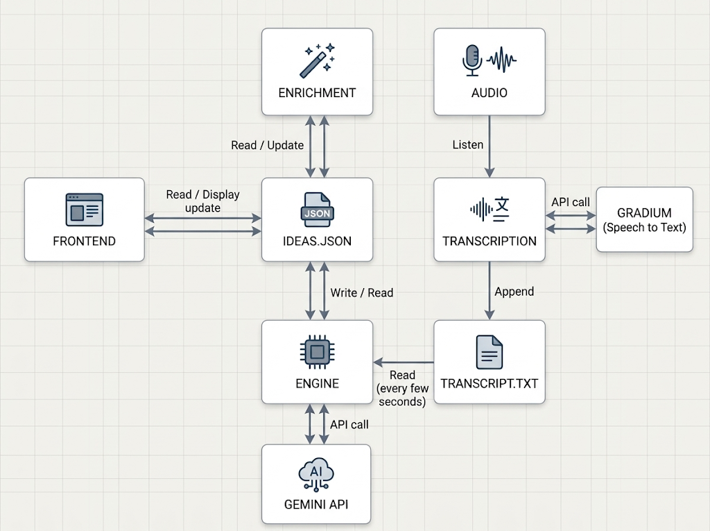

# {Tech: Europe} Zurich Agentic AI Hack

<!-- Replace # with the public demo video URL before submitting. -->
<p align="center">
  <a href="https://drive.google.com/file/d/1SAJt3qMT15nwZS-8X08hiZE9KjyscsY8/view"><strong>Demo</strong></a>
</p>

## What this is

**Brainy Storm** is an application to assist in the brainstorming process. It is a shared workspace for turning a team's spoken discussion into organized ideas, so people can stay in the conversation while AI handles the notekeeping.

The goal is to capture ideas as they emerge, keep their summaries up to date, record the arguments for and against them, research competitors, and track where the team agrees or still has questions. Each idea gets a place on the board that the team can revisit and refine.

## Why we built this

We spent so much time trying to come up with ideas for this hackathon that the brainstorming process itself became our problem to solve.

We kept moving between ideas, raising objections, checking whether something already existed, and circling back to earlier suggestions. Keeping track of all that took attention away from the discussion. We wanted a tool that could follow the conversation with us and preserve the useful parts as our thinking changed.

So we built Brainy Storm: a brainstorming companion that helps a team remember what it considered, why an idea mattered, and what it still needs to decide.

## Architecture

The system is designed around a continuous loop: **conversation → transcription → idea tracking → agent notekeeping → idea board**. Gradium handles speech-to-text, and Gemini powers idea extraction and enrichment.



The diagram shows the shared-file design. The browser reaches the backend through the frontend's API proxy; backend services use local files to retain the discussion and idea records.

### Main components

| Component | Responsibility |
| --- | --- |
| **Frontend** — React, TypeScript, Vite | Captures microphone audio, displays live captions and idea cards, and lets users browse and edit their notes. Proxies browser requests to the backend. |
| **Transcriber** — Python, FastAPI, Gradium | Receives browser audio over a WebSocket, streams it to Gradium, returns live captions, and saves transcript batches. |
| **Idea engine** — Python, Gemini | Processes new transcript chunks, identifies new ideas or updates to existing ones, and generates concise titles and summaries. |
| **Enrichment service** — Node.js, TypeScript, Express, Gemini | Serves idea records and exposes specialized enrichment calls. Competitor research uses Gemini's Google Search grounding. |
| **File storage** | Holds the transcript and idea records locally. Docker Compose mounts `./data` into the backend containers so those files survive container restarts. |

### Notekeeping agents

The notekeeping scope is five focused agent roles:

| Agent | Responsibility |
| --- | --- |
| **Title** | Give each idea a short, recognizable name and update it when the discussion changes its direction. |
| **Summary** | Maintain a concise explanation of the idea, incorporating new details as the conversation develops. |
| **Pros/cons** | Capture the benefits, objections, risks, and tradeoffs raised during the discussion. |
| **Competitor** | Research similar products and approaches, with source links and context on how the idea differs. |
| **Consensus** | Track agreement, disagreement, and unresolved decisions without treating silence as agreement. |

These are logical responsibilities, not five separate containers. Title generation currently lives in the engine alongside its initial summary. The enrichment service contains dedicated summary, pros/cons, and competitor implementations; the separate consensus role is still to be integrated.

### Data flow

1. The browser captures microphone audio and sends it to the transcriber as 24 kHz mono PCM over a WebSocket.
2. The transcriber streams audio to Gradium, sends captions back to the browser, and appends nonempty transcript batches roughly every five seconds.
3. The engine is configured to inspect new text every three seconds, processing chunks of about 500 characters or a smaller remainder after ten seconds of inactivity.
4. Idea tracking and enrichment turn that discussion into structured notes. The frontend polls the enrichment API every three seconds for stored ideas.

<details>
<summary>Current integration status</summary>

This branch still contains an unfinished transition between the shared-file design above and file-based pub/sub messaging:

- The transcriber writes `data/transcript.txt`, while the engine is configured to read `pubsub/transcript.txt`. Compose currently shares only `data/`.
- The engine still references undefined `ideas_path` and `load_ideas`, which must be resolved before live idea extraction can run.
- The frontend currently displays titles and summaries. It does not automatically trigger enrichment or display all five notekeeping outputs. The enrichment API also retains earlier workflow and architecture tools outside the selected five-role scope.
- The frontend imports `data/ideas.json` as seed data, but that directory is excluded from the Docker build and is not mounted into the frontend container.

The commands below describe the existing Compose setup. These integration items need to be completed before the full live demo is ready.

</details>

## How to use this

### Prerequisites

- Docker with the Compose plugin, such as Docker Desktop, installed and running.
- A Gradium API key for transcription and a Gemini API key for idea processing.
- A browser with microphone access and an internet connection for the model APIs.

### Start the application

From the repository root, create a `.env` file containing:

```dotenv
GRADIUM_API_KEY=your_gradium_api_key
GEMINI_API_KEY=your_gemini_api_key
GEMINI_MODEL=gemini-3.8-flash
```

`GEMINI_MODEL` is configurable; the value above is the repository's current default. Set it to a model available to your API key with Google Search grounding support for competitor research. Keep real keys in `.env`, which is ignored by Git.

Validate the configuration, then build and start the four services:

```bash
docker compose config --quiet
docker compose up --build
```

Open **[http://localhost:5173](http://localhost:5173)**. Only the frontend port is published to the host; its proxy handles backend HTTP and WebSocket connections.

### Try a brainstorming session

1. Open the **Hackathon** workspace, click **Start**, and allow microphone access.
2. Discuss an idea aloud: what it does, who it helps, and a few benefits or concerns. Open the transcript panel to follow the captions.
3. Click **Stop** and wait for **Saving…** to finish so the final transcript batch is persisted. Once the engine integration is complete, allow the idle delay and model response time for short recordings to become idea cards.
4. Open an idea card to review or edit its title and notes. Manual edits are saved in that browser.
5. Use **Export transcript** in the transcript panel to download the saved conversation. **Reset transcript** clears the transcript while stopped and preserves stored ideas.

The prototype has one shared recording room and supports one active recording at a time. Live ideas belong to the Hackathon workspace; other browser workspaces do not create separate backend recording sessions.

### Check services and stop the application

```bash
# Inspect running services and follow backend logs.
docker compose ps
docker compose logs -f transcriber engine enricher

# Check local API readiness through the frontend proxy.
curl http://localhost:5173/api/transcriber/health
curl http://localhost:5173/api/enrichment/health

# Stop the stack after recording has finished saving.
docker compose down
```

Health checks confirm local API readiness; they do not make a live Gradium or Gemini request. `docker compose down` preserves files in `./data`.

### Run without Docker

For local development, install **Python 3.13**, **uv**, and **Node.js 22**, and create the same root `.env` file. Run each block in a separate terminal, starting from the repository root:

```bash
# Terminal 1: transcription server
cd backend/transcriber
uv run python main.py
```

```bash
# Terminal 2: idea engine
cd backend/engine
uv run python main.py
```

```bash
# Terminal 3: enrichment API
cd backend/enrichment
npm ci
node --env-file=../../.env --import tsx server.ts
```

```bash
# Terminal 4: frontend
cd frontend
npm ci
npm run dev
```

Open **[http://localhost:5173](http://localhost:5173)**. The frontend uses ports `8000` and `3000` for the local transcriber and enrichment API. Use either Compose or local development at a time to avoid two processes writing to the same files. The Python enrichment implementation in `backend/enrichment` is an alternative implementation and is not part of this four-service setup.

## Contributors

- [Marko Haralović](https://github.com/MarkoHaralovic)

- [Leonarda Lovrić](https://github.com/leonarda4)

- [Giacomo Cirò](https://github.com/giacomo-ciro)

- [Alex John Caldarone](https://github.com/alexcaldarone)
